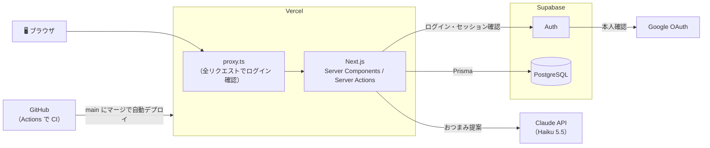
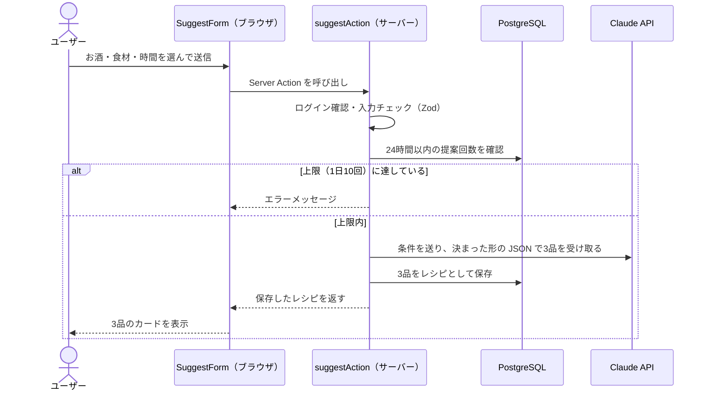

# 🍺 今夜のおつまみ

[](https://github.com/limit23857-blip/otsumami/actions/workflows/ci.yml)

**お酒と冷蔵庫の食材を選ぶと、AI がおつまみを3品提案してくれる Web アプリ**です。
提案されたおつまみは履歴として残り、お気に入りや「作った記録（★評価とメモ）」をつけられます。

🔗 **https://otsumami-psi.vercel.app** （Google アカウントでログインして使えます）

## 作った背景

晩酌のたびに「今日のおつまみ、何にしよう」と迷う時間が地味に面倒だったため、
**お酒の種類・手元の食材・かけられる時間**の3つだけ選べば、すぐ作れるものを提案してくれるアプリを作りました。

業務では Java（Eclipse / SVN）での開発が中心だったため、個人開発では
**TypeScript・クラウド・AI・CI/CD といったモダンな開発の進め方を一通り自分で回すこと**を目標にしています。

## 主な機能

| 機能 | 内容 |
|---|---|
| Google ログイン | Supabase Auth による OAuth ログイン。未ログインのアクセスはログイン画面へ誘導 |
| AI おつまみ提案 | お酒・食材・調理時間を選ぶと、Claude API（Haiku 5.5）が3品を提案 |
| 履歴 | 提案されたおつまみの一覧。お酒の種類・お気に入りで絞り込み、ページ送り |
| お気に入り | ☆ボタンでお気に入り登録。押した瞬間に表示を切り替え、失敗したら元に戻す |
| 作った記録 | 作ったおつまみに★1〜5の評価とメモを残せる。一覧に平均評価と回数を表示 |

## 技術スタック

| 分類 | 技術 |
|---|---|
| 言語 | TypeScript |
| フレームワーク | Next.js 16（App Router / Server Actions / Cache Components）、React 19 |
| スタイル | Tailwind CSS 4 |
| DB / ORM | PostgreSQL（Supabase）、Prisma 7 |
| 認証 | Supabase Auth（Google OAuth） |
| AI | Claude API（`claude-haiku-5-5`）、Structured Outputs |
| バリデーション | Zod |
| テスト | Vitest、React Testing Library |
| CI | GitHub Actions |
| ホスティング | Vercel（main へのマージで自動デプロイ） |

## 構成図



### おつまみ提案の流れ



## 工夫した点

### セキュリティ
- **他人のデータに触れない**: レシピの取得・更新はすべて `src/lib/recipes.ts` に集約し、必ずログイン中のユーザー ID で絞り込んでいます。他人のレシピの ID を URL に入れても 404 になり、お気に入りや記録も変更できません（DB テストで確認）。
- **DB への入口をサーバーに限定**: Supabase の公開 API からテーブルに触れないよう全テーブルで RLS を有効化し、DB へのアクセスは Next.js のサーバー側（Prisma）だけにしています。
- **入力チェックはサーバーでも必ず行う**: 画面側の制限はブラウザで書き換えられるため、Server Action の中で Zod による検証をしています。
- **秘密情報はコードに置かない**: DB の接続文字列や API キーは Vercel の環境変数と手元の `.env`（Git 管理外）にだけ置いています。

### AI まわり
- **Structured Outputs**: AI の回答を「料理名・材料・手順・調理時間」の決まった形の JSON で受け取り、そのまま DB に保存できるようにしています。念のため、品数や調理時間はアプリ側でも整えています。
- **API 料金の使いすぎ防止**: 1人あたり24時間で10回までに制限しています。あわせて Anthropic Console 側でも月の支出上限を設定しています。
- **プロンプトインジェクション対策**: 食材欄に料理と関係のない指示が書かれても従わないよう、システムプロンプトで指示しています。
- **失敗時のメッセージを出し分け**: AI の拒否・混雑・呼び出し失敗をそれぞれ区別し、利用者にわかる言葉で表示しています。
- **モデルは1か所で切り替え**: `src/lib/ai/suggest.ts` の定数を変えるだけで別のモデルに切り替えられます。

### Next.js 16 への対応
- **Cache Components**: ページの枠（ヘッダーなど）は事前に作ってすぐ表示し、ログイン情報が必要な部分だけを `<Suspense>` で後から流し込んでいます。
- **ログイン確認と先読み**: Supabase のトークン検証は現在時刻を使うため、`connection()` で実際のリクエスト時にだけ実行するようにしています。
- **フォームの自動リセット対策**: React 19 はフォーム送信後に入力欄をリセットしますが、提案後に条件を少し変えて再提案しやすいよう、入力内容を保持しています（テストを書く過程でラジオボタンの不具合を発見して修正）。

### 運用で起きたことと対応
- **初回デプロイでビルドが失敗** → ログから原因を特定し、Prisma Client を「実際に DB を使うときに初めて接続する」形に変更。
- **本番のログインで 500 エラー** → Vercel のログから DB の認証エラーを特定し、接続文字列を修正。あわせて、DB エラー時に真っ白な画面ではなくログイン画面へ戻すよう改善。
- **Next.js の脆弱性警告** → `npm audit` で内容を確認し、本番に影響するものはパッチ版へ更新。開発ツールの中だけで使われるものはリスクを判断して保留。

## テストと CI

```bash
npm test          # 単体テスト・画面テスト（DB も AI も使わない）
npm run test:db   # DB を使うテスト（テスト専用の PostgreSQL が必要）
npm run typecheck # 型チェック
npm run lint      # Lint
```

- **AI は偽物に差し替え**てテストしているので、テストで API 料金はかかりません。
- **DB テストは `localhost` の `_test` で終わる DB にしか接続しない**安全装置を入れています（手元の `.env` が本番 DB を指していても、誤ってデータを消さないため）。
- PR を出すと GitHub Actions が **lint → 型チェック → テスト → DB テスト → ビルド** を自動で実行します。DB テストは Actions 上で使い捨ての PostgreSQL を起動して実行しています。

## ディレクトリ構成

```
src/
├── proxy.ts                 # 全リクエストの入口。ログイン確認（Java の Servlet Filter に相当）
├── app/
│   ├── page.tsx             # トップ（おつまみ提案）
│   ├── login/               # ログイン画面
│   ├── auth/                # Google ログインの開始・コールバック・ログアウト
│   ├── suggest/             # 提案フォームと Server Action
│   └── recipes/             # 履歴一覧・詳細・お気に入り・作った記録
├── components/              # 共通のヘッダー、お気に入りボタンなど
└── lib/
    ├── auth.ts              # ログイン中のユーザーを取り出す
    ├── recipes.ts           # レシピのデータ取得（必ず本人のデータに絞る）
    ├── ai/suggest.ts        # Claude API の呼び出し
    ├── prisma.ts            # DB 接続
    └── supabase/            # Supabase クライアント
prisma/
├── schema.prisma            # テーブル定義
└── migrations/              # マイグレーション
tests/db/                    # DB テスト用の設定と安全装置
```

## ローカルでの起動

必要なもの: Node.js 22 以上、Supabase のプロジェクト（Google ログインを有効化済み）、Anthropic の API キー

```bash
git clone https://github.com/limit23857-blip/otsumami.git
cd otsumami
npm ci
cp .env.example .env   # 各値を自分の環境のものに書き換える
npm run dev            # http://localhost:3000
```

DB テストを手元で動かす場合は、Docker でテスト用の PostgreSQL を起動します。

```bash
docker compose up -d
npm run test:db
```

## 今後やりたいこと

- 作った記録の評価をもとに、好みに合わせて提案する（過去の高評価レシピを AI に渡す）
- 自分でレシピを登録・編集する機能
- 開発用と本番用で DB を分ける
- Supabase の無料プランが一時停止しないよう、定期的にアクセスする仕組み
